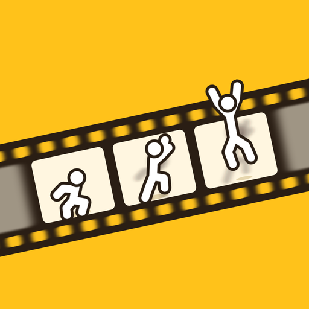

# Stop Motion Virtuose

<p align="center"></p>

Un petit studio de création de films en **stop motion**, pensé pour les enfants et les ados.
Tout fonctionne dans le navigateur, sans installation et sans compte.

## Fonctionnalités

- **Tournage photo par photo** avec la caméra de l'ordinateur, de la tablette ou du téléphone
- **Sur téléphone**, à l'horizontale (conseillé) : l'image à gauche, les outils à droite ; à la verticale : les réglages s'ouvrent dans un tiroir qui monte du bas. Plus besoin de faire défiler la page
- **Calque** : la dernière photo s'affiche en transparence pour bien placer ses personnages
- **Formats** paysage ou portrait, choisis à la création du film
- **Fond vert** : pipette pour choisir la couleur à effacer, vues Résultat / Masque / Original, réglages fins (tolérance, douceur, nettoyage, bords, reflets)
- **12 décors cartoon** : plage tropicale, bateau pirate, sous la mer, ville la nuit, sur la Lune, jungle, château fort, montagne, Far West, volcan, théâtre, manoir hanté — ou tes propres images depuis ta galerie
- **Effets spéciaux** : explosions, BD, nature, magie, effets de caméra, cartons **Titre** et **FIN**
- **Sons des effets** (boum, zap, pouf…) pendant la lecture et dans la vidéo, créés directement par l'appli
- **Photo auto** toutes les 2, 3, 5 ou 10 secondes, pour avoir les deux mains libres
- **Écran toujours allumé** pendant le tournage, et **lumière bloquée** contre le scintillement (sur les téléphones qui le permettent)
- **Conseils de démarrage** pour la première photo
- **Vitesse de lecture** réglable (4 à 24 images par seconde), lecture en boucle, plein écran
- **Annuler** la dernière photo ou la dernière suppression (Ctrl+Z)
- **Doublage** au micro une fois le tournage terminé
- **Export** : la vidéo (avec le fond vert, les effets et la voix) se prépare automatiquement, puis on la **partage** (sur téléphone) ou on la **télécharge**
- **Projets** : rechercher, renommer, dupliquer, exporter la vidéo, supprimer
- **Paramètres** : français / anglais, thème clair ou sombre, son, miroir, grille
- Rubrique **Apprendre** : les bases du stop motion, le fond vert, le doublage et les grands films

## Utilisation

Le plus simple : **https://stop-motion-virtuose.vercel.app** (Chrome, Edge, Safari ou Firefox récents).
Le navigateur demande l'autorisation d'utiliser la caméra et le micro. Une fois ouverte, l'appli marche aussi sans connexion.

Pour la tester sur ton ordinateur, lance un petit serveur dans ce dossier (par exemple `python3 -m http.server`) puis ouvre `http://localhost:8000` : les décors ne s'affichent pas si on ouvre `index.html` en double-cliquant.

## Mettre en ligne avec GitHub Pages

1. Crée un dépôt sur GitHub et envoie le contenu de ce dossier à la racine.
2. Va dans **Settings → Pages**.
3. Dans **Source**, choisis **Deploy from a branch**, puis la branche `main` et le dossier `/ (root)`.
4. Après une minute, l'appli est disponible à l'adresse `https://<ton-pseudo>.github.io/<nom-du-depot>/`.

En ligne (HTTPS), la caméra et le micro fonctionnent aussi sur téléphone, et on peut ajouter l'appli à l'écran d'accueil : elle utilise alors l'icône du dossier `icons`.

## Données

Les films sont enregistrés **uniquement dans le navigateur** de l'appareil utilisé (IndexedDB).
Rien n'est envoyé sur internet. Les films restent sur l'appareil où ils ont été créés.

## Structure

```
index.html        l'application complète (HTML, CSS et JavaScript)
sw.js             fonctionnement hors ligne
manifest.json     informations pour l'installation sur l'écran d'accueil
icons/            icônes de l'application
decors/           les 12 décors (WebP) et leurs vignettes ; decors/source/ contient le script qui les dessine
```

Une connexion internet sert seulement à charger la police Fredoka.
